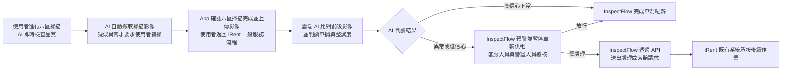

# iRent InspectFlow 產品提案概念說明

版本：V1.4
更新日期：2026 年 10 月 14 日

## 一、產品定位

InspectFlow 是嵌入 iRent 既有取還車流程的「AI 智能車況檢查與整備管家」。InspectFlow 不另外建立租車服務，也不取代 iRent 原有的營運、清潔、維修或索賠系統；InspectFlow 負責改善車況影像的取得方式，並將影像整理成後台人員可以快速理解與處理的車況證據。

產品核心價值可概括為三件事：

1. AI 逐幀即時檢查掃描位置與影像品質，並引導使用者完成六區掃描，確保取得清楚、完整且可比較的車況影像。
2. AI 比較本次取車前與還車後影像並辨識疑似新車損與整潔異常；InspectFlow 隨即提出預警並暫停該車輛供租，避免異常車輛直接放行。
3. InspectFlow 自動完成高信心正常事件的車況紀錄；客服人員與營運人員只需覆核例外案件，並在同一工作台管理車輛與送出後續請求。

目前 Prototype 已呈現手機端六區連續掃描，以及後台異常審核、處理中案件與車輛管理三個核心頁面。Prototype 使用預錄影片、預設判讀結果與模擬 API 狀態來重複展示流程；正式產品則會串接真實相機串流、AI 模型、雲端服務與企業 API。

---

## 二、目標客群

### 2.1 直接使用者

InspectFlow 直接服務 iRent 服務使用者、後台客服人員與營運人員：

| 使用者 | 使用情境 | 核心需求 |
| --- | --- | --- |
| iRent 服務使用者 | 取車或還車時記錄車況 | 快速完成、知道怎麼掃描、避免漏拍與重拍，並留下可保障自身權益的紀錄 |
| 後台客服人員與營運人員 | 審核 AI 篩出的疑似異常、管理正常與處理中車輛 | 減少大量即時看片，只處理例外案件，並快速完成車輛管理與後續請求 |

### 2.2 協作與介接對象

清潔單位、合作維修廠、索賠承辦流程及 iRent 既有營運與索賠系統不是 InspectFlow 的直接使用者。營運人員完成人工確認後，InspectFlow 才會透過 API 將結構化請求傳送至 iRent 既有系統；iRent 既有系統負責管理後續人員、廠商、進度與作業。

---

## 三、痛點分析

### 3.1 租車使用者的痛點

- **拍攝方向不明**：現行自由拍照缺乏即時指引，使用者不確定是否拍對位置、距離與角度。
- **品質問題發現太晚**：使用者通常要到後續流程，才會發現照片因失焦、反光、過暗、遮擋或車身未完整入鏡而無法使用。
- **操作負擔較高**：使用者逐張拍攝時容易漏拍，也需要投入更多時間完成還車操作。
- **車況證據不確定**：使用者即使完成上傳，仍不知道影像是否足以記錄車況並保障自身權益。

### 3.2 後台客服人員與營運人員的痛點

- **審核量大**：正常與異常照片混在一起，人員需要持續逐張查看，容易因疲勞或交接產生遺漏。
- **前後影像難以比較**：不同使用者拍攝的角度與範圍不一致，讓人員難以確認車損或髒污是否為本次新增。
- **異常攔截壓力高**：原始照片缺少異常位置、分類與判讀信心，加上案件量大，可能讓人員誤放尚未處理的異常車輛。
- **後續作業繁瑣**：營運人員完成判斷後，仍需重新整理車號、位置、影像與原因，再將資料轉送至其他系統。

核心痛點不是 iRent 單純缺少車損辨識模型，而是自由拍攝無法穩定產生清楚、可比較且可供營運人員快速判讀的車況影像。

---

## 四、解方設計

### 4.1 完整流程

完整流程可分為掃描、判讀與處理三段：



手機端 AI 會逐幀檢查影像品質，並自動擷取掃描過程中的合格影像；若 AI 發現疑似異常，App 才會要求使用者補掃異常特寫。App 確認六區掃描完成並上傳影像後，會讓使用者返回 iRent 一般服務流程；雲端 AI 則在背景比較前後影像。InspectFlow 只將異常或低信心案件送交人工覆核；iRent 既有系統負責承接後續作業。

### 4.2 手機端設計

InspectFlow 手機端延續 iRent 原有介面語彙，不新增獨立首頁。InspectFlow 將原本的拍照入口改為「掃描」，並保留淺色頁面、紅色主要操作與清楚的車號資訊，以降低使用者的學習成本。

入口頁以六區車輛俯視圖呈現待掃描範圍。使用者按下「掃描車輛狀況」後，App 會直接切換為橫向全螢幕掃描，不再顯示額外說明頁。掃描畫面以全螢幕相機為主，只保留返回按鈕、簡短指令、品質框與右下角六區狀態圖，避免介面資訊遮住車輛。

互動原則包括：

- App 每次只以簡短文字與箭頭提示一個動作，讓使用者直接依畫面完成調整。
- 手機端 AI 會在掃描當下排除位置或品質問題，並在條件穩定後自動擷取影像，不要求使用者再次按下快門。
- 手機端 AI 會自動擷取掃描過程中的合格影像；只有在發現疑似異常時，App 才會要求使用者補掃異常特寫。

### 4.3 手機端功能

- 手機端提供六區連續掃描、即時品質與方向提示、完成狀態，以及最佳影格自動擷取。
- 手機端 AI 辨識車身與前後座的疑似異常，並提供車損、車內外髒污框選及異常特寫補掃。
- App 顯示六區摘要與上傳狀態，並在自動掃描不適用時提供手動拍攝備援。

### 4.4 後台端設計

InspectFlow 後台採用單一營運工作台，不另外提供客服、派工、索賠或管理者情境切換。營運工作台只保留三個核心頁面；每個頁面都使用一致的列式清單，使用者點擊整列即可查看詳情。

#### 異常審核

異常審核頁只顯示尚未處理、尚未送入處理中或索賠流程的案件。異常審核清單呈現車號、偵測結果、異常位置、AI 分類、嚴重程度與車輛狀態，並將髒污明確分成車內髒污與車外髒污。

異常審核詳情頁集中呈現六區影像、同車同區域的本次取車前／還車後比較、必要的歷史基準、異常特寫、AI 建議與車輛資訊。營運人員可執行以下操作：

- 營運人員可送出索賠請求，並同步送出處理請求。
- 營運人員可確認異常，並送出清潔、維修或單純停用請求。
- 營運人員可將案件判定為誤判，並將車輛恢復為正常狀態。

AI 只提供車況建議，獲得授權的客服人員與營運人員仍負責確認最終營運決策。

#### 處理中案件

處理中案件頁集中顯示已送往外部系統的處理事件，包括車輛、處理類型、位置、急迫性與索賠請求狀態。處理中案件詳情頁保留各區影像、異常特寫、車況比較及外部處理狀態。

營運人員可在清單或詳情頁補送尚未提出的索賠請求；InspectFlow 會鎖定已送出的索賠請求，以避免營運人員重複提交。處理中案件頁只追蹤 API 請求與外部系統回傳，不假設 iRent 如何分配清潔人員、維修廠商與排程。

#### 車輛管理

車輛管理頁顯示目前正常的待租與租借中車輛，並提供車號、車型、位置、租用狀態與整潔狀態。營運人員可對待租車輛執行以下操作：

- 營運人員可送出清潔請求，InspectFlow 會將案件移至處理中。
- 營運人員可將車輛判定為異常，InspectFlow 會暫停車輛供租並將案件移至異常審核。

租借中的車輛維持資訊檢視，不允許直接進行營運處置。

### 4.5 後台端功能

三個頁面共用以下能力：

- 營運工作台支援搜尋、篩選及依急迫性排序案件。
- 營運工作台提供一致的清單、詳情與影像檢視方式。
- InspectFlow 同步 API 請求狀態，並防止營運人員重複提交請求。
- InspectFlow 記錄重要操作的時間、原因與操作者。

---

## 五、AI 應用方法

### 5.1 系統架構

系統可分成四個容易理解的部分：

| 層級 | 主要工作 |
| --- | --- |
| 手機 App | 顯示掃描引導，快速檢查影像品質，保存合格影格 |
| 雲端 AI 服務 | 比較前後影像，辨識疑似車損與髒污，整理證據與信心 |
| 營運工作台 | 呈現 AI 結果、影像比較與人工決策操作 |
| iRent 既有系統 | 接收處理或索賠請求，管理後續人員、廠商、進度與結果 |

手機端只執行需要立即回應的輕量判斷；雲端 AI 負責較耗資源的影像對齊、前後比對與異常分析。這項分工可以兼顧掃描流暢度、模型更新彈性與不同手機的效能差異。

因此，手機端只執行輕量視覺推論；雲端 AI 仍負責跨租程檢索、影像對齊與異常分析。

### 5.2 資料流

```text
來自 iRent 的訂單與車輛資料
        ↓
使用者進行六區掃描
        ↓
手機端 AI 逐幀檢查品質並自動擷取合格影像
疑似異常時，App 要求使用者補掃異常特寫
        ↓
App 上傳影像，使用者返回 iRent 一般服務流程
        ↓
雲端 AI 檢索並對齊可比較的前後影像
        ↓
雲端 AI 辨識差異、整合證據並產生車況 Finding
        ↓
InspectFlow 自動完成高信心正常事件
異常或低信心案件由營運人員覆核
        ↓
InspectFlow 放行車輛，或透過 API 送出處理／索賠請求
        ↓
iRent 既有系統回傳處理狀態，更新車輛紀錄
```

每個 Finding 都必須連結原始影像與比較基準。若雲端 AI 找不到足夠的可比影像，InspectFlow 會輸出「證據不足」，而不會直接認定本次租程產生新增損傷。

### 5.3 模型使用

正式產品可組合數個分別處理單一問題的視覺模型與影像技術，不需要由一個模型完成所有判斷。下列模型是目前的候選方案，正式選型仍須以官方資料驗證：

| AI 能力 | 候選模型與技術 | 用途與輸出 |
| --- | --- | --- |
| 掃描引導與品質檢查 | MobileNetV3 輕量分類模型、OpenCV 影像品質規則、TensorFlow Lite／Core ML | 手機端辨識六區視角，檢查清晰度、光線與車身完整度，輸出調整方向及可擷取狀態 |
| 車身與內裝定位 | YOLO Segmentation 或 SegFormer | 分割車身、座椅與局部區域，輸出可比較部位與異常候選範圍 |
| 影像檢索與對齊 | DINOv2 影像特徵檢索、SuperPoint＋LightGlue 特徵配對、RANSAC／Homography 幾何校正 | 找出同車同區域基準並修正角度差，輸出對齊影像與可比程度 |
| 前後差異與異常判讀 | Siamese U-Net 或 ChangeFormer，搭配 YOLO Segmentation／EfficientNet 分類模型 | 比較前後影像並辨識車損、車內髒污與車外髒污，輸出位置、類型、嚴重度與信心 |

AI 不直接決定法律責任、賠償金額或最終索賠結果。AI 負責減少人工搜尋與整理工作，並將判讀的不確定性清楚呈現給營運人員。

### 5.4 技術組成

| 範圍 | 正式版建議技術 |
| --- | --- |
| 手機端 | Flutter 相機串流、傳統影像品質檢查，以及 TensorFlow Lite 或 Core ML 輕量模型 |
| 雲端判讀 | 影像檢索與對齊、車體／內裝分割、損傷與整潔度辨識及證據整合服務 |
| 營運後台 | React 工作台，以及帳號、案件、影像、權限、稽核與狀態 API |
| 系統介接 | REST API 或企業既有規格，連接 iRent 營運與索賠系統 |

大型語言模型不是核心車況判讀模型。若正式產品未來採用大型語言模型，模型可協助整理人工可讀摘要或查詢案件；車況位置、異常類型與信心仍須由可驗證的視覺模型、規則與原始影像支持。

### 5.5 資料使用與模型改善

官方提供的真實照片可以用來了解實際光線、車型、角度與使用者拍攝習慣，也能作為視角辨識與品質判斷的起始資料。不過原始上傳分類不一定等於照片真實內容，正式訓練前仍需清理、抽查與標註。

較適合的資料策略是：

- 資料團隊先清理既有照片，並建立車內外、區域、影像品質與異常位置等一致標註。
- 資料團隊再將同一車輛的取車前、還車後與完工影像整理成可比較組合。
- 模型改善流程會回存人工覆核結果，並依車輛或租程切分訓練、驗證與測試資料，避免高估模型成效。

---

## 六、獨特優勢與差異化

### 6.1 使用者流程前後差異

| 導入前 | 導入後 |
| --- | --- |
| 自行判斷拍攝內容並逐張操作 | 依單一指令完成六區連續掃描 |
| 上傳後才可能發現照片不可用 | 掃描當下檢查品質並自動擷取 |
| 使用者需要逐張拍攝所有照片 | AI 自動擷取掃描影像，疑似異常才要求使用者補掃特寫 |
| 不確定影像是否足以保障權益 | 完成前即可確認六區影像狀態 |

### 6.2 營運流程前後差異

| 面向 | 導入前 | 導入後 |
| --- | --- | --- |
| 審核工作量 | 人工瀏覽大量正常與異常照片 | AI 完成高信心正常事件，人員只看例外案件 |
| 前後比較 | 人工搜尋不同租程影像 | 自動整理同車同區域基準 |
| 異常分類 | 車損與車內外髒污混在一起 | 依類型與位置形成結構化案件 |
| 決策依據 | 影像、車況與處理資料分散 | 同頁查看比較圖、特寫與建議 |
| 後續作業 | 人工重複輸入其他系統 | 以 API 傳送結構化請求 |
| 責任控制 | 可能過度依賴單張照片 | AI 整理證據，人工保留最終決策 |

### 6.3 主要差異化

1. **從影像源頭改善，而非只做事後辨識**：手機端 AI 先確保影像可用，雲端 AI 再判讀車損，降低輸入影像不可判讀的問題。

2. **建立完整證據流程**：InspectFlow 串接掃描、同租程前後比對與營運處理，形成可查看、可覆核及可送出的案件。

3. **例外導向的人機協作**：AI 直接完成高信心正常事件；InspectFlow 只對疑似異常要求補掃，並將例外案件送交人工覆核。

4. **API-first，不重做 iRent 內部系統**：InspectFlow 專注於影像與決策證據，iRent 既有系統負責後續執行。

---

## 七、預期效益

現階段尚未取得 iRent 的現況基準與正式試點結果，因此不宣稱固定改善百分比。預期效益應以試點前後數據驗證。

### 7.1 使用者體驗

- 即時掃描引導可降低使用者不知道怎麼拍與反覆重拍的挫折。
- 自動擷取可縮短使用者對準與確認各區影像所需的時間。
- 六區連續掃描可提高使用者一次完成檢查的比例與影像完整率。
- 六區摘要可讓使用者確認 InspectFlow 已留下可判讀的車況紀錄，提升使用者對流程的信任。

建議指標：掃描完成時間、首次合格率、平均調整次數、流程放棄率及使用者滿意度。

### 7.2 車況判讀品質

- 標準化掃描可提高影像清晰度、區域完整度與前後可比性。
- 手機端品質檢查可降低反光、角度差異及漏拍造成的誤判。
- 雲端 AI 可將疑似車損、車內髒污與車外髒污轉為結構化紀錄。
- InspectFlow 可將證據不足案件明確分流，降低 AI 過度判定的風險。

建議指標：可判讀率、不可比率、異常召回率、誤報率、人工推翻率及補件率。

### 7.3 營運效率

- InspectFlow 自動完成高信心正常事件的車況紀錄，可減少營運人員瀏覽正常影像與搜尋歷史照片的時間。
- 營運工作台可縮短營運人員從發現異常到送出處理請求的時間。
- 結構化車況證據可減少營運人員在不同系統間重複整理車號、位置與影像的工作。
- API 請求可讓處理與索賠資料採用一致格式，並保留完整追蹤紀錄。

建議指標：單案人工審核時間、每日可處理案件量、異常至送出請求時間及人工操作步驟數。

### 7.4 車輛與風險管理

- 即時預警可讓營運人員更快隔離確實需要處理的車輛。
- 人工覆核可降低正常車輛因資訊不足而長時間停用的情況。
- 前後影像證據可提高營運人員判斷新舊異常與責任時所需資料的完整度。
- 可追溯的車況時間軸可支援後續維修、清潔與車型品質分析。

建議指標：平均停用時間、誤停用比例、處理完成時間、爭議案件補件率及車況紀錄完整率。

---

## 八、落地評估

### 8.1 技術可行性

InspectFlow 所需的手機相機串流、影像品質判斷、車輛與內裝辨識、影像配對、異常偵測、雲端運算與 API 介接，都已有成熟的技術基礎。正式產品的主要挑戰不是單一技術是否存在，而是 AI 在不同車型、光線、停車場環境與拍攝條件下能否維持穩定準確度。

Prototype 已驗證主要操作概念與畫面流程；正式產品仍需串接真實相機、模型服務、帳號權限、資料儲存、狀態同步與企業 API。

### 8.2 資料可行性

官方提供的流程資料與真實使用者照片足以支援前期資料盤點、品質分析及視角模型研究，但正式車損模型仍需要更明確的異常標註、同車前後影像配對與人工覆核結果。團隊也必須依競賽規範、個資要求與企業授權使用資料。

### 8.3 系統整合可行性

InspectFlow 採用 API-first 架構，可先作為獨立的車況分析服務接入現有流程，不需要一次替換整套 iRent 系統。導入前，iRent 與開發團隊需要確認以下介接條件：

- iRent 需要提供訂單、車輛、取還車時間與位置資料的取得方式。
- iRent 需要確認影像上傳、車輛狀態與索賠請求的 API 規格。
- 外部處理系統需要回傳請求狀態與處理結果。
- iRent 需要定義清潔、維修、停用、放行及索賠的操作權限。

### 8.4 營運可行性

正式產品不應直接改變 iRent 未公開的派工與合作廠商流程。較低風險的作法，是先讓 InspectFlow 提供標準化證據與人工確認入口，再由 iRent 既有系統承接後續處理。這種分工能降低人員教育、流程改造與組織調整成本。

### 8.5 風險與控制

| 風險 | 控制方式 |
| --- | --- |
| 不同車型與環境造成辨識不穩定 | 依車型與區域驗證，低信心轉人工 |
| 反光或陰影被誤認為損傷 | 手機端先做品質引導，多張影像交叉確認 |
| 缺少可比較的取車前影像 | 標示證據不足，使用歷史基準補充但不自動定責 |
| 使用者掃描時間過長 | 正常流程只做六區掃描，異常才補掃 |
| AI 誤判影響客戶權益 | 人工覆核、保留原圖與完整稽核紀錄 |
| 個資或非目標車牌進入影像 | 上傳前後進行遮罩、權限及保存期限管理 |
| 與現有營運流程不一致 | 透過 API 接入，先確認企業 SOP 再設定狀態規則 |

### 8.6 建議導入方式

1. **離線驗證**：資料團隊整理資料與標註規則，模型團隊驗證影像品質及異常辨識能力。
2. **小規模試點**：iRent 與開發團隊選定少量車型與區域，測試掃描流程及營運操作。
3. **影子模式**：AI 只提供判讀建議；營運人員比較 AI 與人工結果，InspectFlow 不改變車輛狀態。
4. **受控上線與擴大**：iRent 先保留人工確認，待系統達成品質與效率目標後，再逐步增加車型、區域及自動化程度。

---

## 九、目前 Prototype 與正式產品的界線

| 項目 | 目前 Prototype | 正式產品目標 |
| --- | --- | --- |
| 手機端 | Flutter App，以本機影片與時間軸模擬連續掃描 | 串接真實相機與手機端品質模型 |
| 掃描結果 | 固定腳本模擬六區完成、刮痕與後座髒污 | 依真實影像動態判斷與擷取 |
| 後台端 | React、TypeScript 與固定假資料呈現三個核心頁面 | 串接帳號、案件資料、影像與企業狀態 |
| AI 判讀 | 以預設結果展示使用流程 | 雲端模型實際產生 Finding 與信心 |
| 處理與索賠 | 模擬 API 請求及跨頁狀態變化 | 串接 iRent 既有營運與索賠系統 |
| 資料保存 | 本機展示資料 | 具備權限、稽核、加密與保存期限的正式資料服務 |

Prototype 用來驗證使用者是否理解掃描指引、營運人員是否能快速完成判斷，以及三頁工作台是否符合決策需求。正式導入階段則需要使用企業資料、現行流程與 API，將 Prototype 的互動轉為可實際運作的服務。

## 十、總結

InspectFlow 的差異不在於單純增加一個車損辨識模型，而是重新設計從「怎麼掃描」到「怎麼處理」的完整車況資料流程。手機端 AI 提高影像品質並降低使用者負擔，雲端 AI 整理前後差異與異常證據，營運工作台讓營運人員保留最終決策，InspectFlow 再透過 API 將請求送回 iRent 既有系統。

InspectFlow 採用上述分工，不需要取代 iRent 現有營運架構，即可逐步提升影像可用性、人工審核效率、車況追溯能力與使用者信任，並為後續模型改善與流程自動化建立可靠的資料基礎。
